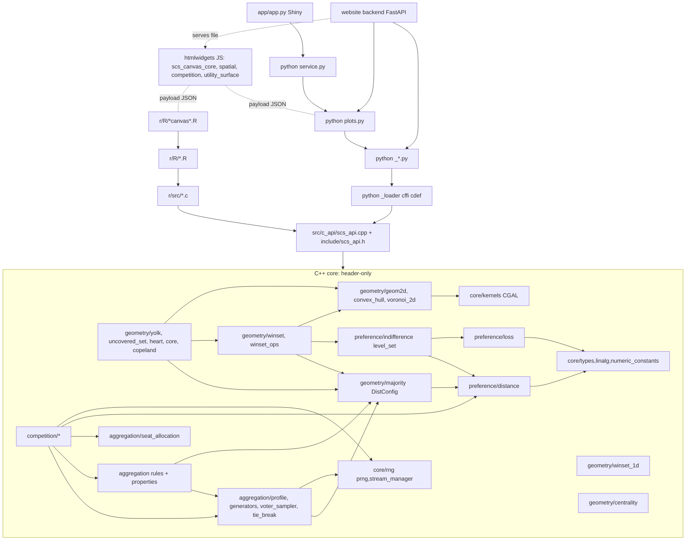

# Stage 01 — Architecture map
Model / effort: Opus / high   Commit: 3f19579   Website commit: 03d9c52

Working tree at start: ` M docs/status/follow_up_queue.md` (3 pre-existing lines), `?? docs/reviews/`.
Line counts below are `wc -l` at 3f19579. Coverage figures are from `stage_00_baseline.md`
(C++ = ctest-only llvm-cov lines %; R = covr; Py = pytest-cov).

## 1. One-paragraph overview

SocialChoiceLab (product name SocialChoiceStudio) is a research and teaching toolkit for
spatial and ordinal social choice: distance/loss utility models, indifference curves, majority
preference, winsets, Yolk, uncovered set, Heart, Copeland/Condorcet, preference profiles,
positional/approval voting rules, aggregation properties, and an agent-based multi-candidate
competition engine (Laver-style Sticker/Hunter/Aggregator/Predator). Users are political
scientists and students working in R or Python, plus nontechnical users of a hosted Shiny for
Python app (one workflow: scenario → winset figure → HTML export) and a separate local FastAPI
website (one workflow: a 2D competition run). The stack is strictly layered: **header-only C++20
core** (Eigen; CGAL EPEC for exact 2D polygons) → **one stable C ABI** (`include/scs_api.h`,
`src/c_api/scs_api.cpp`, built as `libscs_api` shared library; error codes + caller buffers +
opaque handles) → **two thin bindings** that must stay behaviourally identical (R: `.Call` into
hand-written C glue in `r/src/`, R6 wrappers in `r/R/`; Python: cffi ABI-mode with a hand-copied
cdef in `_loader.py`) → **visualization** (R/Python build JSON payloads; shared, byte-identical
HTML5-canvas/Three.js widgets render them) → **applications** (`python/.../service.py` +
`app/app.py` Shiny MVP; `socialchoicestudiowebsite/backend` FastAPI). Released `v0.3.0`; project is
pre-open (no backward-compatibility obligation except faithful replicas of published algorithms).

## 2. Layer and module map

| Module (path) | Purpose | Key types / functions | Depends on | Lines | Stage 0 coverage |
|---|---|---|---|---|---|
| core basics `include/socialchoicelab/core/{types,linalg,kernels,numeric_constants}.h` | Point aliases, Eigen include, CGAL kernel aliases, tolerance constants | `Point2d/Point3d/PointNd` (Eigen), `EpecKernel`, `EpicKernel`, `k_near_zero_rel=1e-9`, `k_near_zero_abs=1e-12` | Eigen, CGAL | 132 | n/a (aliases) |
| core/rng `core/rng/{prng,stream_manager}.h`, `src/core/rng/stream_manager.cpp` | Seeded mt19937_64 PRNG; named-stream manager with allowlist; global singleton | `PRNG` (`uniform_int/real`, `normal`, `beta`, `discrete_choice`, `engine()`), `StreamManager` (`register_streams`, `get_stream`, `reset_all`, `reset_for_run`, `combine_seed`, `generate_stream_seed`), `get_global_stream_manager`, `voters_rng()`… | std | 698 | prng 95.6%, stream_manager.h 90.0%, .cpp 90.5% |
| preference/distance `preference/distance/distance_functions.h` | Weighted Minkowski family (Convention B), validation | `DistanceType`, `minkowski/euclidean/manhattan/chebyshev_distance`, `calculate_distance`, `k_minkowski_chebyshev_cutoff=100` | numeric_constants | 296 | 95.0% |
| preference/loss `preference/loss/loss_functions.h` | Loss → utility (u = −L(d)) | `LossFunctionType`, `linear/quadratic/gaussian/threshold_loss`, `distance_to_utility`, `normalize_utility`, `UtilityNormalizer` | numeric_constants | 359 | 90.5% |
| preference/indifference `preference/indifference/level_set.h` | Exact level-set shapes, sampling, IC polygons | `LossConfig`, `DistanceConfig`, `LevelSet2d` variant (`Circle2d/Ellipse2d/Superellipse2d/Polygon2d`), `level_set_1d/2d`, `to_polygon`, `ic_polygon_2d` | distance, loss, types | 410 | **65.4%** |
| geometry primitives `geometry/{geom2d,convex_hull,majority,centrality}.h` | Exact types/conversions; hull; pairwise majority; centrality | `Point2E/Segment2E/Polygon2E/Line2E`, `to_exact/to_numeric`, `convex_hull_2d`, `DistConfig`, `majority_prefers`, `preference_margin`, `pairwise_matrix`, `weighted_majority_prefers`, `marginal_median_2d`, `centroid_2d`, `geometric_mean_2d` | core, distance, CGAL | 698 | geom2d **33%**, others 97–100% |
| geometry winsets `geometry/{winset,winset_ops,winset_1d}.h` | 2D k-majority winset (CGAL GPS), veto, weighted, boolean ops; 1D interval | `WinsetRegion` (`General_polygon_set_2<Gps_segment_traits_2<Epeck>>`), `winset_2d`, `winset_2d_petal`, `winset_with_veto_2d`, `weighted_winset_2d`, `winset_union/…`, `winset_interval_1d` | majority, level_set, geom2d | 763 | winset.h **57.0%**, ops 100%, 1d 92% |
| geometry solution concepts `geometry/{yolk,uncovered_set,heart,core,copeland}.h` | k-Yolk (LP-yolk approx.), covering/uncovered set, Heart, Condorcet/core, Copeland | `quantile_lines_2d`, `limiting_quantile_lines_2d`, `Yolk2d`, `yolk_2d`, `covers`, `uncovered_set`, `uncovered_set_boundary_2d`, `heart`, `heart_boundary_2d`, `condorcet_winner`, `core_2d`, `copeland_scores/winner` | majority, winset, convex_hull | 1,350 | yolk 98.5%, heart 97.7%, US/core/copeland 100% |
| geometry Voronoi `geometry/voronoi_2d.h` | Euclidean Voronoi cells clipped to bbox | `voronoi_cell_2d`, `voronoi_cells_2d(const double*…)` | geom2d, CGAL | 199 | 100% |
| aggregation profiles `aggregation/{profile,profile_generators,voter_sampler,tie_break}.h` | Ordinal profiles from space/utilities; generators; tie-breaking | `Profile`, `build_spatial_profile`, `profile_from_utility_matrix`, `is_well_formed`, `uniform/gaussian_spatial_profile`, `impartial_culture`, `VoterSamplerConfig`, `draw_voters`, `TieBreak`, `break_tie` | geometry/majority, prng | 503 | voter_sampler **51.1%**, generators 88%, tie_break 88%, profile 100% |
| aggregation rules `aggregation/{plurality,borda,antiplurality,scoring_rule,approval}.h` | Positional + approval rules (scores / all_winners / one_winner) | `*_scores`, `*_all_winners`, `*_one_winner(profile, TieBreak=kRandom, PRNG*=nullptr)`, `borda_ranking`, `approval_*_spatial/_topk` | profile, tie_break | 564 | 87–100% |
| aggregation properties `aggregation/{social_ranking,pareto,condorcet_consistency}.h` | Rankings, Pareto, Condorcet/majority predicates | `rank_by_scores`, `pairwise_ranking`, `pareto_set`, `condorcet_winner_profile`, `is_condorcet_consistent`, `is_majority_consistent` | profile, geometry/majority | 368 | 94–100% |
| aggregation seats `aggregation/seat_allocation.h` | Seat rules used by competition | `plurality_top_k_seat_allocation`, `hare_largest_remainder_allocation` | std | 124 | 80.2% |
| competition model `competition/{competition_types,competitor,initialization}.h` | Enums/configs/state; deterministic init | `CompetitorStrategyKind` (incl. undocumented `kHunterSticker`), `CompetitionBounds`, `StepPolicyConfig`, `CompetitorState`, `initialize_competitors`, stream names `competition_init_*` | types, stream_manager | 404 | types **64.3%**, init 89.7% |
| competition strategies `competition/{adaptation,strategy_registry}.h` | Strategy services and registry | `AdaptationContext`, `StrategyDecision`, `CompetitorStrategyService`, `StrategyRegistry::built_in()`, `random_in_backward_halfspace` | competitor, stream_manager | 409 | adaptation 71.1%, registry 74.0% |
| competition motion `competition/{motion,step_policy,boundary_policy}.h` | Step size + boundary handling | `resolve_step_size`, `apply_boundary_policy`, `advance_competitor_state` | adaptation | 197 | 87.5–100% |
| competition election `competition/election_feedback.h` | Per-round profile, plurality votes, seats, supporters | `build_spatial_profile_nd`, `evaluate_election_feedback`, `apply_feedback_to_competitors`, `SeatRuleKind` | aggregation, distance | 188 | 80.8% |
| competition engine `competition/{engine,termination,state_signature}.h` | Synchronous round loop, trace, early stop | `CompetitionEngineConfig`, `CompetitionTrace` (stores `geometry::DistConfig`), `run_competition_round`, `run_fixed_round_competition`, `TerminationConfig` | all competition | 512 | engine 80.8%, termination **60.3%**, signature 83% |
| competition experiments `competition/experiment_runner.h` | Serial replications/sweeps | `CompetitionExperimentConfig`, `run_competition_experiment`, `run_competition_sweep`, `run_seed_for_index` | engine, stream_manager | 223 | 78.1% |
| C API header `include/scs_api.h` | Stable C ABI: version, error codes, POD configs, opaque handles, 124 `SCS_API` functions | `SCS_OK..SCS_ERROR_OUT_OF_MEMORY(0–4)`, `SCS_LossConfig`, `SCS_DistanceConfig`, `SCS_LevelSet2d`, `SCS_Yolk2d`, `SCS_VoronoiCellsHeap`, handles `SCS_StreamManager/Winset/Profile/CompetitionTrace/CompetitionExperiment` | — | 2,020 | n/a |
| C API impl `src/c_api/scs_api.cpp` | `extern "C"` wrappers, validation, C↔C++ mapping | `set_error` :113, `validate_finite_doubles` :123, `to_dist_config` :160, `to_cpp_competition_engine_config` :463, `WINSET_BINOP` :1922, `resolve_prng` :2942 | all core headers | 4,660 | **59.9%** (1,531 missed; test_c_api only) |
| R package R code `r/R/*.R` (14 files) | User API, R6 classes (`StreamManager`, `Winset`, `Profile`, `CompetitionTrace`, `CompetitionExperiment`), plotting payloads | see NAMESPACE (93 exports) | `.Call` glue, R6, htmlwidgets, jsonlite | 4,590 (non-plot 2,777; plot 1,813 incl. `plot_utility_surface` functions.R:432–497) | total 88.9%; stream_manager.R **48.7%**, winset.R **64%**, profile.R **68%**, competition.R 76.7% |
| R package C glue `r/src/*.c`, `scs_r_helpers.h`, `init.c`, `Makevars` | SEXP↔C marshalling; 113 registered routines; finalizers; 0→1-based outputs | `scs_check` (scs_r_helpers.h:28), `build_dist_config/build_loss_config`, `R_RegisterCFinalizerEx` | `libscs_api` via `-lscs_api` | 2,991 (+40 Makevars) | stream_manager.c **51%**, winset_1d.c 79%, others 84–100% |
| Python package core `python/src/socialchoicelab/_*.py`, `__init__.py`, `scenarios.py` | cffi loader + cdef, error mapping, config types, handle classes, functions | `_loader._lib/_ffi`, `_error._check` :48, `DistanceConfig`, `LossConfig`, `StreamManager`, `Winset`, `Profile`, `CompetitionTrace`, `CompetitionExperiment`, rule functions | cffi, numpy, `libscs_api` | 5,211 | 91% total; `_loader` **60%**, `_winset` 80%, `_stream_manager` 84%, `_competition` 86% |
| Python plotting `plots.py`, `palette.py` | Canvas payloads, HTML writers, overlays, `.scscanvas` save/load, utility surface | `plot_spatial_voting`, `layer_*`, `animate_competition_canvas`, `render_spatial_voting_html`, `save_plot`, `plot_utility_surface` | core modules | 2,123 | plots 93%, palette 97% |
| Python service `service.py` | JSON-in/JSON-out MVP entry (Python-only by design) | `run_spatial_voting_mvp` | plots, winset, scenarios | 306 | 91% |
| JS widgets `r/inst/htmlwidgets/*.js` (Python copies byte-identical) | Canvas renderers; Three.js surface | `ScsCanvasCore`, `SpatialVotingCanvas`, `CompetitionCanvas`, utility surface widget | htmlwidgets (R) / inline HTML (Py), three.min.js (vendored) | 4,604 (+15 yaml) | not measured |
| Shiny app `app/` | Hosted MVP UI (not deployed; Dockerfile unverified) | `_build_request`, `server`, `_scenarios_with_status_quo` | `socialchoicelab` Python | 222 app + 98 tests + 49 Dockerfile | not in CI |
| Website backend `socialchoicestudiowebsite/backend/app/` | FastAPI local GUI for one competition run | `POST /api/competition/run`, `run_competition`, `generate_uniform_voters`, `_build_canvas_payload`, `bootstrap.ensure_socialchoicelab_importable` | sibling `../socialchoicelab/python/src` via `sys.path`, `SCS_LIB_PATH` | 465 py + 565 static + 200 tests | not measured |

Tests: C++ `tests/unit/*.cpp` 12,140 lines (36 ctest suites; `test_c_api.cpp` 3,456); R testthat 3,239; Python pytest 3,453.

## 3. Dependency graph

Layering notes (noted, not investigated):
- **Aggregation → geometry**: `aggregation/profile.h`, `approval.h`, `social_ranking.h` include `geometry/majority.h` and use its `DistConfig` and the *detail* helper `geometry::detail::voter_distance` (aggregation_design.md §1). Cross-module use of a `detail` namespace.
- **Competition → geometry type**: `CompetitionTrace::distance_config` is a `geometry::DistConfig` (engine.h:37) reached only transitively through `aggregation/profile.h`.
- `competition/election_feedback.h:44` `build_spatial_profile_nd` re-implements `aggregation::build_spatial_profile` (profile.h:96) for N-D — duplicated logic.
- `aggregation/seat_allocation.h` is used only by competition.
- C-style raw-pointer signatures inside the core: `winset_interval_1d(const double*, int, double)` (winset_1d.h:43), `voronoi_cells_2d(const double*, …)` (voronoi_2d.h:164).
- Three distance-config types (`preference::indifference::DistanceConfig`, `geometry::DistConfig`, C `SCS_DistanceConfig`) plus binding-side `DistanceConfig`/`make_dist_config`; `geometry::DistConfig` defaults to 2 unit weights (majority.h:47).
- No core → competition dependency; no binding includes C++ headers (C ABI only) — the main rule holds.
- **Visualization contract** (Design_Document.md § Design Principles/Visualization Contract): R/Python compute Euclidean IC circles locally when `dist_config` is NULL (plots.py:1307–1309, spatial_voting_canvas.R:262–263); JS computes Euclidean distances for competition stats regardless of metric (competition_canvas.js:2318–2323, labelled "display heuristic"); utility surface contours are marching squares in JS (utility_surface_canvas.js:147).
- Website imports the library by inserting `../socialchoicelab/python/src` into `sys.path` (bootstrap.py:46–62) and serves `competition_canvas.js` straight from that package directory (main.py:43–62).
- Unused in-repo: `get_global_stream_manager()` and `voters_rng()`…`analysis_rng()` (stream_manager.h:304–331) have no callers outside their own files.

## 4. Key data flows

**4.1 Spatial voters → distance/loss → profile → voting-rule winner**
| Layer | Python | R |
|---|---|---|
| User | `profile_build_spatial(alts, voters, dist_config)` (_profile.py) → `plurality_one_winner(p, tie_break="smallest_index", stream_manager, stream_name)` (_voting_rules.py:125) | `profile_build_spatial()` (profile.R) → `plurality_one_winner()` (voting_rules.R:85) |
| Glue | `_types._to_cffi_dist` → `_lib.scs_profile_build_spatial`; `_resolve_tb` :44 → `_lib.scs_plurality_one_winner`; `_error._check` | `.Call("r_scs_profile_build_spatial")` (r/src/profile.c); `.Call(r_scs_plurality_one_winner)` returns `out + 1` (voting_rules.c:69) |
| C API | `scs_profile_build_spatial` (scs_api.cpp:2551) → `SCS_ProfileImpl{Profile}`; `scs_plurality_one_winner` :3027 → `resolve_prng` :2942 (mgr->mgr.get_stream(name)) | same |
| Core | `aggregation::build_spatial_profile` (profile.h:96) → `geometry::detail::voter_distance` (majority.h:79) → `preference::distance::calculate_distance` (distance_functions.h:273, weights inside the power); `plurality_one_winner` (plurality.h:69) → `plurality_all_winners` → `break_tie` (tie_break.h:48) | same |
Utility path: `distance_to_utility` → `scs_distance_to_utility` (:646) → `loss::distance_to_utility` (loss_functions.h:183). Utility-matrix path: `scs_profile_from_utility_matrix` (:2587) → `profile_from_utility_matrix` (profile.h:145).

**4.2 Geometry (2D; CGAL EPEC where noted)**
- Winset: `winset_2d()` (R winset.R / Py _winset.py) → `scs_winset_2d` (:1373; `validate_winset_inputs` :1346, `to_dist_config` :160 requires exactly 2 weights) → `geometry::winset_2d` (winset.h:257): per-voter preferred-to polygon `detail::pts_polygon` (:109, sampled from `level_set_2d`/`to_polygon`, double) → `to_exact_polygon` → incremental depth-update with CGAL `General_polygon_set_2` (exact) → `SCS_WinsetImpl`. Export: `scs_winset_boundary_size_2d` (:1590) + `scs_winset_sample_boundary_2d` (:1611) via `collect_rings` (:1576), or one-shot `scs_winset_2d_export_boundary` (:1711) used by plotting. Boolean ops `WINSET_BINOP` (:1922).
- Yolk: `scs_yolk_2d` (:1969) → `geometry::yolk_2d` (yolk.h:335): EPEC k-quantile lines at 720 sampled + n(n−1)/2 critical directions (`quantile_lines_2d` :92), then double subgradient minimax. `dist_cfg` validated, ignored (Euclidean only). **Not bound in R or Python** (absent from `_loader.py` cdef and r/src).
- Uncovered set: discrete `scs_uncovered_set_2d` (:2282) → `uncovered_set` (uncovered_set.h:124) → `covers` (:78) → `majority_prefers` (double); continuous `scs_uncovered_set_boundary_2d` (:2345) / `_heap` (:2379) → `uncovered_set_boundary_2d` (:192; grid + 30% margin + `convex_hull_2d` EPEC) → `export_polygon2e` (:2033). Indices returned via `find_alt_index` exact equality (:2023).
- Heart: `scs_heart_2d` (:2435) → `heart` (heart.h:87; beats matrix, start from uncovered set, iterate T); `scs_heart_boundary_2d` (:2514) → `heart_boundary_2d` (:216; grid + hull). **Not bound in R or Python.**
- Core: `scs_core_2d` (:2241) → `core_2d` (core.h:150): candidates = Yolk centre + voter ideals; returns first with empty `winset_2d`. Condorcet over finite alternatives: `scs_condorcet_winner_2d` (:2200) → `condorcet_winner` (core.h:95). Copeland: `scs_copeland_scores_2d` (:2060) → `copeland_scores` (copeland.h:59).
- Exactness boundary: inputs are doubles; distances/majority comparisons are double; CGAL EPEC is used for polygon construction/booleans (winset, hull, quantile lines, Voronoi clipping); outputs are converted back with `to_numeric` (geom2d.h:67).

**4.3 Competition: setup → engine → trace / experiment**
- User: Py `competition_run(competitor_positions, strategy_kinds, voter_ideals, competitor_headings, dist_config, engine_config, stream_manager)` (_competition.py) with `CompetitionEngineConfig/StepConfig/TerminationConfig`; R `competition_run()` with `make_competition_engine_config()` etc. (utils.R). Strategy strings → ints (`_STRATEGY_INT` _competition.py:24; competition.R:272).
- C API: `scs_competition_run` (:4050): null/size/finite checks → `to_cpp_competition_engine_config` (:463) + `to_competition_dist_config` (:267) → **bounds inferred as bbox(initial competitors ∪ voters) ± 1.0** (:4083–4103) → `build_competitors` → `competition::run_fixed_round_competition(cfg, competitors, voters, mgr ? &mgr->mgr : nullptr)` (engine.h:285).
- Core loop per round (`run_competition_round`, engine.h:191): active competitors → `evaluate_election_feedback` (election_feedback.h:125: `build_spatial_profile_nd` → `plurality_scores` → seat rule) → `apply_feedback_to_competitors` → `StrategyRegistry::adapt` (strategy_registry.h; Hunter uses stream `competition_adaptation_hunter`) → `advance_competitor_state` (motion.h:46: `resolve_step_size` step_policy.h:34 uses `competition_motion_step_sizes`; `apply_boundary_policy` boundary_policy.h:28) → termination checks (termination.h). Trace = per-round `CompetitionRoundRecord` + `final_competitors` + `distance_config`.
- Export: `SCS_CompetitionTraceImpl` (:77); getters `scs_competition_trace_*` (:4129–4353, two-call size/fill with `copy_positions` :506 / `copy_double_vector` :530); `scs_competition_trace_dist_config` (:4168).
- Experiments: `scs_competition_run_experiment(…, master_seed, num_runs, retain_traces)` (:4354) → `run_competition_experiment` (experiment_runner.h:166): one local `StreamManager(master_seed)`, per run `reset_for_run(master_seed, run)` + `register_competition_streams` (2 streams) → summaries (`summarize_run`). Getters `scs_competition_experiment_*` (:4428–4660).
- Visualization: `animate_competition_canvas(trace, …)` (plots.py:730 / competition_canvas.R) reads trace + `dist_config()`, builds payload; overlays via `_serialise_overlays_static` (plots.py:289) and `_build_overlays_frames` (:325) calling `ic_polygon_2d`, `scs_winset_2d_export_boundary`, `scs_voronoi_cells_2d_heap`; 1D via `scs_ic_interval_1d`, `scs_winset_interval_1d`. Save/load `.scscanvas` (`_save_scsview` :513, `load_competition_canvas` :1220).

**4.4 RNG: seeding and stream delivery**
- Creation: Py `StreamManager(master_seed, stream_names)` (_stream_manager.py:44; `int(master_seed)`, optional allowlist) / R `StreamManager$new()` / `stream_manager()` → `scs_stream_manager_create` (:3498) → `SCS_StreamManagerImpl{core::rng::StreamManager}` (:571); `scs_register_streams` (:3513).
- Stream seed = SplitMix64(master ^ (FNV1a(name)<<1) ^ (FNV1a(name)>>1)) (stream_manager.h:285–299); streams created lazily on `get_stream`; `reset_all` clears streams, keeps allowlist; `reset_for_run` uses `combine_seed` (:261–269).
- Consumers: direct draws `scs_uniform_real/normal/bernoulli/uniform_int/uniform_choice` (:3603–3705); tie-breaks via `resolve_prng` (:2942) for `*_one_winner`, `borda_ranking`, `rank_by_scores`, `pairwise_ranking_from_matrix`; generators `scs_profile_impartial_culture/uniform_spatial/gaussian_spatial` (:2630–2774; alternatives drawn first, then voters, same stream); `scs_draw_voters` (:2778); competition run uses the caller's manager (Hunter + step-size streams); experiment runner owns its own manager. Draws use std distributions over `mt19937_64`; several call sites pass `prng.engine()` directly (`tie_break.h:66`, `profile_generators.h:151` `std::shuffle`, `step_policy.h:46`).
- Website: one `StreamManager(seed, ["competition_adaptation_hunter","competition_motion_step_sizes","web_voter_generation"])` for voters, a second with the same seed for the run (simulation.py:14–18, 118–135).

**4.5 Plotting: binding → overlay schema → JS canvas**
- Static: `plot_spatial_voting()` (plots.py:172 / spatial_voting_canvas.R) builds a payload dict (`voters`, `sq`, `alternatives`, `layers`, theme, auto range `_padded_range` 12%) → `layer_winset` (plots.py:1384; `scs_winset_2d_export_boundary`), `layer_ic` (:1268; local circle or `ic_polygon_2d`), `layer_preferred_regions` (:1330), `layer_convex_hull` (:1501), `layer_uncovered_set` (:1461), `layer_yolk` (:1437; caller supplies centre/radius), `layer_centroid/marginal_median` → R: `htmlwidgets::createWidget("spatial_voting_canvas")`; Py: `render_spatial_voting_html` (:1552) / `save_plot` (:1579) via `_html_from_spatial_payload` (:464) inlining `scs_canvas_core.js` + `spatial_voting_canvas.js` → `SpatialVotingCanvas.setData` (spatial_voting_canvas.js:964) → `draw` (:1042).
- Competition: payload with `positions`, `vote_shares`, `overlays_static`, `overlays_frames` (contract: docs/architecture/canvas_overlay_schema.md) → `CompetitionCanvas.setData` (competition_canvas.js:713), `getCompetitionOverlayEntries` (:57), `_drawOverlaysStatic` (:1010), `draw` (:2004).
- Utility surface: `plot_utility_surface` (plots.py:1655 / functions.R:432) evaluates `calculate_distance` + `distance_to_utility` on an N×N grid via the C API → Three.js widget builds surface + marching-squares contours.

**4.6 Website / hosted app request → Python binding → result**
- Website: `POST /api/competition/run` (main.py:65) → pydantic `CompetitionRunRequest` (models.py:81; strategies limited to 4, no size caps observed) → `simulation.run_competition` (simulation.py:138) → `generate_uniform_voters` (:118) → `scl.competition_run(...)` with Euclidean unit weights → trace getters → `_build_canvas_payload` (:63, re-implements part of `plots.py`) → `CompetitionRunResponse`; errors: ValueError→400, unavailable→503, other→500 generic.
- Shiny MVP: `server` (app.py:158) → `_build_request` (:109) → `scl.run_spatial_voting_mvp(request)` (service.py) → `plot_spatial_voting` + `layer_winset`/`layer_convex_hull`/`layer_ic`/`layer_preferred_regions` → `render_spatial_voting_html` → iframe; download serves same HTML.

## 5. Cross-cutting conventions

| Concern | Convention | Representative location |
|---|---|---|
| Errors, C++ core | Throw `std::invalid_argument` with function-prefixed message for bad input; no error codes | distance_functions.h:132; majority.h:68–76 (`resolve_k`) |
| Errors, C API | Pre-checks (null, sizes, finiteness via `validate_finite_doubles` :123) → `try` → `catch invalid_argument`→`SCS_ERROR_INVALID_ARGUMENT`(1), `bad_alloc`→`SCS_ERROR_OUT_OF_MEMORY`(4, some sites), `std::exception`→`SCS_ERROR_INTERNAL`(2); message via `set_error` :113; handle-returning functions return `NULL`; destroys are `void`, NULL-safe. Counts: 122 `extern "C"`, 84 `catch (const std::exception&`, 9 `catch (bad_alloc`, 1 `catch (...)` | scs_api.cpp:580–641 (`scs_calculate_distance`); :4050–4123 |
| Errors, Python | `_check(rc, err_buf)` maps codes to `SCSInvalidArgumentError/SCSInternalError/SCSBufferTooSmallError/SCSOutOfMemoryError` (base `SCSError`); 512-byte buffers (`_ERR_BUF_SIZE` repeated per module); handle-returning calls raise `SCSError` directly | _error.py:48–66; _stream_manager.py:46–51 |
| Errors, R | `scs_check(rc, err_buf)` → `Rf_error("%s", msg)` (longjmp); R-level argument checks in `r/R/utils.R` (`.resolve_k`, `.check_tie_break_args`) | scs_r_helpers.h:28–32 |
| Ownership: handles | Opaque `typedef struct X##Impl X`; create returns owned pointer; `scs_*_destroy` (`delete`, NULL no-op). Bindings: Python `__del__` + context manager; R external pointer + `R_RegisterCFinalizerEx` | scs_api.cpp:65–84, :1489; _winset.py:46–55; r/src/winset.c:27–28 |
| Ownership: buffers | Caller-provided buffers with explicit capacity; NULL/0 capacity = size query; too small → `SCS_ERROR_BUFFER_TOO_SMALL`, no truncation | `scs_winset_boundary_size_2d` :1590 + `scs_winset_sample_boundary_2d` :1611; `export_polygon2e` :2033 |
| Ownership: heap variants | Library `malloc`s; caller frees with `scs_heap_free` or a dedicated destroy | `scs_voronoi_cells_2d_heap` :1841 / `scs_voronoi_cells_heap_destroy` :1908; `scs_uncovered_set_boundary_2d_heap` :2379 / `scs_heap_free` :105 |
| Borrowed inputs | `SCS_DistanceConfig.salience_weights` is caller-owned for the call only; R borrows `REAL(w)` from a PROTECTed list | c_api_design.md §SCS_DistanceConfig; scs_r_helpers.h:45–53 |
| Tolerances | `k_near_zero_rel=1e-9`, `k_near_zero_abs=1e-12`, local scale (PEP 485 style); Minkowski fast paths when |p−1|,|p−2| < 1e-9; p ≥ 100 → Chebyshev; uncovered/heart grids; winset `num_samples=64`; Yolk 720 directions + 10,000 iterations; competition `signature_resolution` default 1e-6 | numeric_constants.h:22–27; distance_functions.h:145, :167; scs_api.cpp:454 |
| Exact vs double | EPEC (`Exact_predicates_exact_constructions_kernel`) for `Point2E/Polygon2E/Line2E`, winset GPS, hull, quantile lines, Voronoi clipping; double for distances, majority counts, profiles, Yolk optimiser, Voronoi bisector construction (`to_double` then EPEC); exact `==` used for alternative lookup and scoring-rule ties | geom2d.h:35–48; winset.h:76–85; voronoi_2d.h:51–63; scs_api.cpp:2023 |
| Randomness | No `random_device`/`rand()` in include/ or src/ (grep clean). All draws from named streams of a caller-owned `StreamManager`; FNV-1a + SplitMix64 seeding; `reset_for_run` for replications; `TieBreak::kRandom` requires a PRNG; C API random tie-break requires `mgr` + registered `stream_name` | stream_manager.h:96–152, :255–299; tie_break.h:48–68; experiment_runner.h:178–186 |
| R/Python parity | Process rule only (`.cursor/rules/R-Python-Layer-Parity.mdc`): mirrored function names, mirrored test files, shared JS. Mechanisms are manual: Python cdef hand-copied in `_loader.py` (120 of 124 header functions; missing yolk/heart), R `init.c` registration table (113 routines), duplicated JS and scenario JSON copies (currently byte-identical; no check in CI or scripts). Indexing: Python 0-based; R 1-based with `-1L` in R code and `+1` in C glue | _loader.py:70–875; r/src/init.c; social.R:116; voting_rules.c:69 |

## 6. Stated invariants and contracts

1. Distance weighting is Convention B: `d = (Σ (wᵢ|xᵢ−yᵢ|)^p)^(1/p)`; weights finite, ≥ 0, 0 = dimension masking; invalid input throws. — Design_Document.md §2 Preference Services. Matches distance_functions.h:120–175.
2. Minkowski requires finite p ≥ 1; for p ≥ 100 the result is Chebyshev ("heuristic; revisit if a formal bound is needed"). — WHERE_WE_ARE.md Backlog 38 / Item 6; distance_functions.h:31, :167. ⚠ possible mismatch with "Minkowski (p≥1)" semantics in Design_Document.md §2 and with `test_distance_speed.cpp:170` (S00-001).
3. Utility = −L(d); loss parameter domains enforced; `normalize_utility` returns 1.0 for a degenerate range. — Design_Document.md §2; WHERE_WE_ARE.md Items 21, 28.
4. 2D level sets: Euclidean equal weights → circle; unequal → axis-aligned ellipse (r/wᵢ); Manhattan/Chebyshev → exactly 4-vertex polygon; Minkowski 1<p<∞ → superellipse; unreachable level → empty (1D). — indifference_design.md §Outputs, §Algorithm notes; c_api_design.md §SCS_LevelSet2d (max 4 inline vertices).
5. Indexing: C++ core and C API 0-based; R shifts to 1-based at the binding boundary; return named objects where possible. — aggregation_design.md §1; Design_Document.md §R binding.
6. Profile rankings: `rankings[i][0]` most preferred; equal distances / equal utilities broken by ascending alternative index; `is_well_formed` = permutation check. — aggregation_design.md §1.
7. Tie-break default is `kRandom` for every `*_one_winner` "for simulations and user-facing code"; tests pass `kSmallestIndex`. — aggregation_design.md §3. ⚠ possible mismatch: R and Python default `tie_break = "smallest_index"` (voting_rules.R:86, _voting_rules.py:127); the C++ default `kRandom` with default `prng = nullptr` throws on any tie (plurality.h:69–72, tie_break.h:60–65).
8. C API random tie-break requires non-null `mgr` and a registered `stream_name`, else `SCS_ERROR_INVALID_ARGUMENT`. — c_api_design.md §SCS_TieBreak.
9. Majority: strict preference; equidistant voters count for neither side; default k = ⌊n/2⌋+1; k ∈ [1, n]. — geometry_design.md §6; majority.h:63–76.
10. Ordinal Condorcet: a beats b iff count > ⌊n/2⌋; `is_condorcet_consistent` vacuously true without a Condorcet winner. — aggregation_design.md §8.
11. Approval (spatial): approve iff distance ≤ threshold; empty result if no approvals. — aggregation_design.md §5.
12. Scoring vector non-increasing, length m; score ties compared with `==` (known limitation). — aggregation_design.md §4, §9.
13. Pareto set always non-empty; Condorcet winner always Pareto-efficient. — aggregation_design.md §7.
14. Winset: preferred-to sets approximated by `num_samples`-gon (default 64), boundary error O(1/num_samples²), boolean ops exact; result "Empty iff a k-majority Condorcet winner exists at sq". — geometry_design.md §7; winset.h:252–254. ⚠ possible mismatch: the "iff" is stated for an approximated region (winset.h:32–36 says the boundary is approximate).
15. Winset boundary export: rings do not repeat the closing vertex; holes flagged by `out_path_is_hole`, bindings must not infer topology from winding; empty winset → `bbox` sets `*out_found=0`, leaves outputs untouched. — c_api_design.md §C2.6. ⚠ possible mismatch with canvas_overlay_schema.md §Polygon format ("closed — last point equals first, or JS closes it"; "Outer rings CCW, holes CW").
16. Yolk = smallest disk meeting all k-quantile lines; implementation is an LP-yolk approximation; radius 0 iff Condorcet winner at centre; Euclidean only (`dist_cfg` validated but not applied). — yolk.h:22–28, :300–303; WHERE_WE_ARE.md §Known Issues, §C3. ⚠ possible mismatch: geometry_design.md §9 shows `yolk_2d(voter_ideals, k)` and calls the centre the "centre of gravity"; header has `n_sample` (yolk.h:335–337); c_api_design.md usage example comments "smallest circle intersecting all median lines" (:580).
17. Uncovered-set boundary: grid over voter bbox + 30% margin, convex hull of uncovered grid points, "conservative outer bound within the sampled region". — uncovered_set.h:159–181. ⚠ possible mismatch on default resolution: C++ default 30 (uncovered_set.h:194, geometry_design.md §10) vs C API/R/Python default 15 (scs_api.h:61; geometry.R:189; _geometry.py:307).
18. Heart: Heart ⊆ uncovered set; non-empty; Condorcet winner → singleton; computed as fixed point of T starting from the uncovered set; "smallest set satisfying" the condition. — heart.h:8–31; geometry_design.md §13. ⚠ possible mismatch: iterating T downward from the uncovered set yields the largest fixed point inside it, not the "smallest"; cited source (Laffond, Laslier & Le Breton 1993) is the bipartisan-set paper (see §7).
19. `core_2d` is heuristic: checks Yolk centre + voter ideals only; cannot prove absence. — geometry_design.md §11; core.h:120–146. ⚠ core.h:135–139 says under unanimity a Condorcet winner "always exists" and in the next sentence that every interior point loses.
20. Copeland: score = wins − losses; ties → first occurrence / smallest index; Copeland winner ∈ uncovered set. — geometry_design.md §12.
21. Convex hull = Pareto set only under Euclidean uniform salience; must not be labelled "Pareto Set" under a non-Euclidean config. — ROADMAP.md §Non-Euclidean; canvas_overlay_schema.md §Metric support.
22. Voronoi cells: Euclidean only, clipped to bbox, one simple polygon per site, empty cells allowed, `out_cell_start` length n_sites+1. — c_api_design.md §C2.8; voronoi_2d.h:146–160.
23. C API: no exception crosses the boundary. — scs_api.cpp:6–9; ROADMAP §C API wrapper tooling. ⚠ possible mismatch: only one `catch (...)` in 122 entry points; `WINSET_BINOP` (scs_api.cpp:1922–1938) catches only `std::exception`.
24. Every non-destroy handle API rejects NULL handles with `SCS_ERROR_INVALID_ARGUMENT`; destroys accept NULL. — c_api_design.md §Error handling.
25. Non-finite doubles rejected at the C boundary, core need not tolerate them. — c_api_design.md §Input validation; WHERE_WE_ARE.md §C8.
26. Variable-size outputs: size-query via NULL/0 capacity; too small → `SCS_ERROR_BUFFER_TOO_SMALL`; never silently truncate. — c_api_design.md §Error handling, §Stability. ⚠ c_api_design.md:428–431 lists `scs_level_set_to_polygon` without `out_capacity`, contradicting :223 and scs_api.h:354–357.
27. New ABI-visible mode/result values use fixed-width `int32_t`, not C enums. — c_api_design.md §Scalar domains. ⚠ possible mismatch: `SCS_LossType`, `SCS_DistanceType`, `SCS_LevelSetType`, all `SCS_Competition*` enums, `SCS_VoterSamplerKind` are C enums (scs_api.h:107, 135, 162, 1229–1264, 1396).
28. Versioning: matching major = ABI-compatible; minor = additive; competition API declared stable at v0.3.0. — c_api_design.md §Files, §API stability. ⚠ `SCS_API_VERSION` is 0.2.0 (scs_api.h:29–31); CMake project 0.1.0 (CMakeLists.txt:2); packages 0.3.0. `SCS_DEFAULT_YOLK_SAMPLES` documented (c_api_design.md:139) but absent from scs_api.h.
29. Stability: no signature-breaking changes; deprecation period. — c_api_design.md §Stability and deprecation. ⚠ conflicts with `.cursor/rules/No-Backward-Compat-Until-Open.mdc` (replace directly until open).
30. Thread safety: stateless functions (incl. all geometry) thread-safe; `SCS_StreamManager` not; `err_buf` per call. — c_api_design.md §Thread-safety (C0.5). (Not verified for CGAL EPEC lazy numbers.)
31. StreamManager single-owner; `get_stream` references invalidated by `reset_all`, `reset_for_run`, `clear`, `remove_stream`; allowlist makes unknown names throw; `reset_all` keeps allowlist. — stream_manager_design.md R1–R5; stream_manager.h:23–50; experiment_runner.h:179–183.
32. Seeds portable across compilers/platforms (FNV-1a, no `std::hash`). — stream_manager_design.md R4; stream_manager.h:271–280. ⚠ scope: only seeds are portable; draws use `std::*_distribution` and `std::shuffle`, whose outputs are library-specific (prng.h:68–261; profile_generators.h:151).
33. No hidden randomness; one responsibility per stream; tie-break stream documented. — stream_manager_design.md R6, R9, R10.
34. Experiment runner is serial; run i reproducible alone via `reset_for_run(master_seed, i)`; reported `run_seed` equals the seed used. — competition_design.md §Experiment runner; experiment_runner.h:66–83.
35. Competition: synchronous rounds; trace stores evaluated state per round plus final states; inactive competitors excluded from ballot and motion; supporter ties by ascending competitor index; Hare LR deterministic fallback when all votes are zero; dimensions 1 and 2 only. — competition_design.md §Phase A, §Electoral evaluation, §Engine semantics; engine.h:57–71.
36. Competition stream map: five named streams (`competition_init_positions/headings/step_sizes`, `competition_motion_step_sizes`, `competition_adaptation_hunter`). — competition_design.md §Stream map. Runner allowlist registers only the last two (experiment_runner.h:85–91).
37. Strategies are Sticker, Hunter, Aggregator, Predator (Laver 2005; Laver & Sergenti 2011). — competition_design.md §Current status. ⚠ code also has `kHunterSticker` / `"hunter_sticker"` (competition_types.h:20; scs_api.h:1234; R/Python maps) with no design-doc entry or citation.
38. `CompetitionTrace` records the `DistanceConfig` it ran under; `animate_competition_canvas` defaults overlay configs to it and errors for Voronoi on non-Euclidean traces. — c_api_design.md constraint 33; engine.h:30–37.
39. Visualization layers are pure renderers; all metric-dependent geometry comes from C++ via the C API. — Design_Document.md §Design Principles, §Visualization Contract. ⚠ possible mismatch: see §3 (local Euclidean ICs in R/Python; Euclidean stats and marching-squares contours in JS).
40. R and Python share the same canonical JS files. — Design_Document.md §Visualization Contract. Holds today by copy (byte-identical), not by build.
41. Overlays off by default; absent keys hidden. — canvas_overlay_schema.md §JS rendering defaults.
42. Service layer request/response are JSON-serializable; validation errors are `ValueError` with what/entered/fix. — application_service_layer.md §Contract.
43. End-user error messages state what failed, what was entered, how to fix. — .cursor/rules/End-User-Error-Messages.mdc. ⚠ many C API messages are generic (e.g. "null pointer or non-positive n_dims", scs_api.cpp:588).
44. Spatial profile generators draw `n_alts` alternatives first, then voters, from the same distribution and stream. — WHERE_WE_ARE.md §C5.
45. Weighted winset: weights rounded to multiples of min_weight/weight_scale (default 100), GCD-reduced voter expansion. — winset.h:495–509; geometry_design.md §7 (calls it "exact proportional representation").
46. `geometric_mean_2d` requires strictly positive coordinates. — WHERE_WE_ARE.md §centrality.

## 7. Published algorithms

| Algorithm / concept | File | Cited source (as written) | Faithful replica claimed? |
|---|---|---|---|
| Weighted Minkowski distance (Convention B) | preference/distance/distance_functions.h | Minkowski (1910); Enelow & Hinich (1984) (geometry_design.md §16) | no |
| Linear loss | preference/loss/loss_functions.h | Singh (2013) | no |
| Gaussian (reverse-S) loss | loss_functions.h | Conevska-Mutlu (2025) | no |
| Quadratic / threshold loss | loss_functions.h | "traditional spatial voting" (none) | no |
| Level sets / superellipse IC | preference/indifference/level_set.h | none (Lamé curve named) | no |
| Stream seeding FNV-1a + SplitMix64 finalizer | core/rng/stream_manager.h | FNV URL; "SplitMix64-style" (no paper) | unclear (constants verbatim) |
| Convex hull | geometry/convex_hull.h | CGAL manual §2D Convex Hulls; Pareto = hull: McKelvey (1976) | no (library) |
| Majority preference / pairwise | geometry/majority.h | Plott (1967); McKelvey (1976) | no |
| Winset, incremental depth update | geometry/winset.h | Plott (1967); McKelvey (1979); CGAL Boolean Set-Operations | no (own algorithm; petal method as reference) |
| Veto-player winset | winset.h | Tsebelis (1995) in code; Tsebelis (2002) in geometry_design.md | no |
| Weighted winset (voter expansion) | winset.h | "not a published algorithm" (geometry_design.md §16) | no |
| 1D winset interval | geometry/winset_1d.h | Black (1948); Plott (1967) | no |
| k-quantile / limiting median lines | geometry/yolk.h | Feld, Grofman & Miller (1988); Grofman, Owen & Noviello (1987); Miller (2015) | no |
| Yolk (LP-yolk, sampled directions + subgradient) | yolk.h | Feld, Grofman & Miller (1988); doc: Ferejohn, McKelvey & Packel (1984); recommended Tovey (1990/1992), Koehler (1992); replacement candidates Gudmundsson & Wong (2019) | no (explicitly an approximation) |
| Covering relation / uncovered set | geometry/uncovered_set.h | Miller (1980); McKelvey (1986); Feld, Grofman & Miller (1988) | unclear |
| Uncovered-set boundary (grid + hull) | uncovered_set.h | none (own approximation) | no |
| Heart (finite fixed point) | geometry/heart.h | Laffond, Laslier & Le Breton (1993) "The Bipartisan Set of a Tournament Game"; Banks (1985); McKelvey (1986) | unclear (citation may not define the Heart; see §6 item 18) |
| Heart boundary (grid + hull) | heart.h | none (own approximation) | no |
| Condorcet winner / core_2d | geometry/core.h | Plott (1967); McKelvey (1979); Schofield (1983) | no (heuristic search) |
| Copeland score / strong point | geometry/copeland.h | Copeland (1951); Miller (1980); Banks (1985); Moulin (1986) | no |
| Marginal median, centroid, geometric mean | geometry/centrality.h | Black (1948); Enelow & Hinich (1984); Poole & Rosenthal (1985) | no |
| Euclidean Voronoi (half-plane clipping) | geometry/voronoi_2d.h | none | no |
| Plurality | aggregation/plurality.h | Dummett (1984) (doc) | no |
| Borda count | aggregation/borda.h | Borda (1784) | no |
| Anti-plurality | aggregation/antiplurality.h | Fishburn (1977) | no |
| Positional scoring rules | aggregation/scoring_rule.h | Young (1975) | no |
| Approval voting (spatial, top-k) | aggregation/approval.h | Brams & Fishburn (1978, 1983) | no |
| Pareto efficiency | aggregation/pareto.h | Pareto (1906); Arrow (1951) | no |
| Condorcet / majority consistency | aggregation/condorcet_consistency.h | Condorcet (1785); Arrow (1951) | no |
| Impartial culture (Fisher–Yates) | aggregation/profile_generators.h | Guilbaud (1952/1966); Gehrlein & Lepelley (2011) (doc); Fisher–Yates named | no |
| Hare largest remainder | aggregation/seat_allocation.h | none | no |
| Sticker / Hunter / Aggregator / Predator | competition/strategy_registry.h, adaptation.h | Laver (2005); Laver & Sergenti (2011); in code Fowler & Laver (2008) §2, Laver (2012) ch.3 | unclear (described as "per Laver 2005 and Laver & Sergenti 2011") |
| Hunter-Sticker | strategy_registry.h:164 | none | unclear |
| Termination (epsilon, cycle signature, no-improvement) | competition/termination.h | none ("operational") | no |
| KDE voter heatmap | competition_canvas.js:958, spatial_voting_canvas.js:345 | none | no (display only) |

## 8. Known issues already on record

| # | Issue | Source |
|---|---|---|
| K1 | `yolk_2d` is an LP-yolk approximation (Stone & Tovey 1992; Hu & Bailey 2024); replace (Gudmundsson & Wong 2019 top candidate); not exposed in bindings/MVP | WHERE_WE_ARE §Known Issues; MILESTONE_GATES §Deferred; ROADMAP §Yolk and Heart |
| K2 | `heart_boundary_2d` is a 15×15 grid + hull approximation; continuous Heart is an open problem | WHERE_WE_ARE §Known Issues; MILESTONE_GATES §Deferred |
| K3 | Pareto set under non-Euclidean metrics not implemented (hull is a proxy/outer bound; must not be labelled Pareto) | ROADMAP §Non-Euclidean; geometry_design §15 |
| K4 | Voronoi (candidate regions) Euclidean only; generalisation planned | ROADMAP §Non-Euclidean; c_api_design §C2.8 |
| K5 | Yolk/Heart/Uncovered set/Core unverified under non-Euclidean metrics; bindings must warn/error | ROADMAP §Non-Euclidean |
| K6 | Competition overlay guard implemented (trace dist_config); other non-Euclidean items remain open | ROADMAP §Non-Euclidean; HANDOFF |
| K7 | Systematic review of test correctness against theory still pending | ROADMAP §Test correctness review |
| K8 | Paper draft repeats false Borda/Condorcet (Fishburn) claim; unit test already fixed | ROADMAP §Release ladder; follow_up_queue §Not a short task |
| K9 | `core_2d` not exhaustive; winset boundary error depends on `num_samples`; heart O(m⁴) | geometry_design §15 |
| K10 | Profile ties broken by index only; scoring-rule float equality; no N-D profiles; no weighted voters | aggregation_design §9 |
| K11 | `app/Dockerfile` not build-verified; no hosting provider; no user pilot; no request/time/rate limits for public deployment | follow_up_queue; HANDOFF; hosted_mvp_design §Not yet done |
| K12 | Only 3 of 34 scenarios have a status quo; app dropdown filtered; decision pending | follow_up_queue; hosted_mvp_design |
| K13 | Service layer is Python-only by design (no R port) | HANDOFF; application_service_layer §Why Python-only |
| K14 | Desktop packaging cancelled | HANDOFF |
| K15 | Status docs (WHERE_WE_ARE, HANDOFF) say the nontechnical-release work is uncommitted; it is committed (`fbc52da`…`aa19b05`) | WHERE_WE_ARE §Current phase; HANDOFF §Goal (observed stale) |
| K16 | Trim WHERE_WE_ARE; reduce status-doc overlap; add `.claude/settings.json` read blocks (uncommitted lines) | follow_up_queue (working tree) |
| K17 | Not short tasks: yolk replacement, Heart boundary, Characteristics of Voting Rules, per-run position re-randomization, PrefLib import, release number for unreleased work | follow_up_queue §Not a short task; ROADMAP |
| K18 | `libscs_api` has no VERSION/SOVERSION; Windows `SCS_API_BUILD` switch is "should" | c_api_design §ABI |
| K19 | Parallel IC construction not investigated | ROADMAP §Parallel processing |
| K20 | S00-001: `DistanceSpeedTest.AccuracyCheck` fails at p=100 (up to 3.26e-9) | stage_00 §Summary |
| K21 | R CMD check: 2 WARNINGs (R header warning group; GNU make extensions in `Makevars`) | stage_00 §7 |
| K22 | clang-tidy tool reports (unverified): ArrayBound `scs_api.cpp:1894`, NewDeleteLeaks `yolk.h:229`, exception-escape `strategy_registry.h:54`, 23 unchecked-optional, 25 implicit-widening | stage_00 §8 |
| K23 | Low coverage files (C++ geom2d 33%, voter_sampler 51%, winset 57%, scs_api.cpp 60%, termination 60%, competition_types 64%, level_set 65%; R stream_manager 49–51%, winset.R 64%, profile.R 68%; Py `_loader` 60%) | stage_00 §5–7 |
| K24 | ruff F/B items (unused imports/variables, B017 broad raises) and lintr object_usage lints | stage_00 §8 |

## 9. Slice plan check for Stages 2–9

Line counts are real source (`wc -l`). Target 1,500–3,000 per agent. Changes from the README are marked **adjusted**.

**Stage 2 — C++ core (4 agents, confirmed)**
| Slice | Files | Lines |
|---|---|---|
| 2a core + rng + preference | `include/socialchoicelab/core/{types,linalg,kernels,numeric_constants}.h`, `core/rng/{prng,stream_manager}.h`, `src/core/rng/stream_manager.cpp`, `preference/distance/distance_functions.h`, `preference/loss/loss_functions.h`, `preference/indifference/level_set.h` | 1,895 |
| 2b geometry | `geometry/{geom2d,convex_hull,majority,centrality,winset,winset_ops,winset_1d,yolk,uncovered_set,heart,core,copeland,voronoi_2d}.h` (all 13 headers) | 3,010 |
| 2c aggregation | `aggregation/{profile,profile_generators,voter_sampler,tie_break,plurality,borda,antiplurality,scoring_rule,approval,social_ranking,pareto,condorcet_consistency,seat_allocation}.h` (13 headers) | 1,559 |
| 2d competition | `competition/{competition_types,competitor,initialization,adaptation,strategy_registry,motion,step_policy,boundary_policy,election_feedback,engine,termination,state_signature,experiment_runner}.h` (13 headers) | 1,933 |
Context docs: 2a stream_manager_design.md, indifference_design.md; 2b geometry_design.md; 2c aggregation_design.md; 2d competition_design.md, competition_plan.md.

**Stage 3 — C API (1 header agent + 3 slices, confirmed; ranges proposed)**
| Slice | Exact ranges | Functional group | Lines |
|---|---|---|---|
| 3h header contract | `include/scs_api.h` 1–2020 + `docs/architecture/c_api_design.md` | ABI types, ownership, error/size contracts, versioning, doc↔header consistency | 2,020 (+629 doc) |
| 3a | `scs_api.cpp` 1–265 and 565–1964 | Preamble, impl structs, version/`scs_heap_free`, shared helpers (`set_error`, `validate_finite_doubles`, `copy_int_vector`, `to_dist_config`, loss/dist mapping, `build_voters`), `SCS_StreamManagerImpl`, distance, loss, level sets/IC, convex hull, majority/pairwise, winset factories/lifecycle/boundary export, 1D winset, `scs_winset_2d_export_boundary`, Voronoi (size/fill/heap), winset boolean ops, clone | 1,665 |
| 3b | `scs_api.cpp` 1965–3493 and 3706–4048 | Yolk, C4 helpers (`find_alt_index`, `export_polygon2e`), Copeland, Condorcet/core, uncovered set (+heap), Heart, profile constructors, `scs_draw_voters`, profile lifecycle/export, C6 helpers (`resolve_prng`, `fill_int_winners`), all voting rules, approval, profile clone, C7 rankings/Pareto/Condorcet predicates, centrality | 1,872 |
| 3c | `scs_api.cpp` 266–564, 3494–3705, 4049–4660 | Competition helpers (dist/engine/termination config mapping, `copy_positions`, shares), StreamManager lifecycle + PRNG draws, competition run/trace/experiment API | 1,123 |
Slices 3b and 3c must read 108–265 (shared helpers, inside the anonymous namespace closed at 565) as context. Leak runs: 3a runs `leaks --atExit -- test_c_api --gtest_filter` for its groups; 3b the profile/rule/C4 groups plus pytest; 3c the StreamManager/Competition groups plus R testthat.

**Stage 4 — C++ tests (adjusted: 6 agents instead of 2; 12,140 lines cannot fit 2 agents at ≤3,000)**
| Slice | Files | Lines |
|---|---|---|
| 4a core/preference | `test_core_types, test_distance_functions, test_distance_comparison, test_distance_speed, test_performance_comparison, test_loss_functions, test_level_set, test_prng` | 1,987 |
| 4b geometry I | `test_geom2d, test_convex_hull, test_majority, test_winset, test_winset_ops, test_winset_1d, test_voronoi_2d, test_core, test_copeland` | 1,769 |
| 4c geometry II | `test_yolk, test_uncovered_set, test_heart, test_centrality, test_geometry_integration` | 2,027 |
| 4d aggregation + competition | `test_profile, test_voting_rules, test_aggregation_properties, test_aggregation_integration, test_voter_sampler, test_seat_allocation, test_competitor_initialization, test_competition_strategies, test_competition_motion, test_competition_election_feedback, test_competition_engine, test_competition_termination, test_competition_experiment_runner` | 2,901 |
| 4e C API tests I | `test_c_api.cpp` 1–1909 (Distance … Winset/Voronoi/WinsetInterval1d groups, StreamManager, Competition) | 1,909 |
| 4f C API tests II | `test_c_api.cpp` 1910–3456 (Yolk … NonFinite) + read 1–47 for helpers | 1,547 |
At the 3,000-line cap, 12,140 lines need at least 5 agents; 6 keeps each slice to one functional area.

**Stage 5 — Bindings (adjusted: 4 agents; plotting files moved to Stage 7)**
| Slice | Files | Lines |
|---|---|---|
| 5a R code | `r/R/{competition,functions (1–431),geometry,profile,scenarios,social,stream_manager,utils,voter_sampler,voting_rules,winset}.R`, `r/DESCRIPTION`, `r/NAMESPACE` | 2,899 |
| 5b R C glue | `r/src/{competition,functions,geometry,init,profile,social,stream_manager,voronoi,voting_rules,winset,winset_1d}.c`, `scs_r_helpers.h`, `Makevars`, `Makevars.win` | 3,031 |
| 5c Python infra | `_loader.py`, `_error.py`, `_types.py`, `_stream_manager.py`, `_functions.py`, `_geometry.py`, `__init__.py`, `scenarios.py`, `pyproject.toml` | 2,882 |
| 5d Python objects | `_competition.py`, `_profile.py`, `_social.py`, `_voting_rules.py`, `_winset.py` | 2,367 |
5c must diff the `_loader.py` cdef against `scs_api.h` (4 functions absent: yolk, heart ×3).

**Stage 6 — Parity (adjusted: 1 Haiku + 3 Sonnet; binding tests had no stage)**
| Slice | Files | Lines |
|---|---|---|
| 6a inventory (Haiku) | `r/NAMESPACE`, function signatures in `r/R/*.R`, `python/.../__init__.py`, public `def`s in all Python modules incl. `plots.py` | signatures only |
| 6b non-plot behaviour + tests | R: `test_competition, test_config, test_functions, test_geometry, test_objects, test_package, test_scenarios, test_voter_sampler, test_voting_social, helper_lib, testthat.R`; Py: `test_b5, test_b8, test_competition, test_import, test_scenarios, test_voter_sampler` | 2,918 |
| 6c static plot tests | R `test_plots.R, test_palette.R, compound_api_interactive_common.R, test_compound_api_interactive.R`; Py `test_plots.py, test_palette.py, test_compound_api_interactive.py` | 1,811 |
| 6d competition canvas tests | R `test_competition_canvas_{1d,ic,save_load,voronoi,winset}.R`; Py `test_competition_canvas_{1d,ic,save_load,voronoi,winset}.py` | 1,855 |

**Stage 7 — Plotting and JS (adjusted: 4 agents; R copy of JS is canonical, verify Python copies with `cmp`)**
| Slice | Files | Lines |
|---|---|---|
| 7a static plot bindings | `r/R/spatial_voting_canvas.R`, `r/R/palette.R`, `plots.py` 1–288, 399–512, 1268–1603, `palette.py` | 1,955 |
| 7b competition + surface bindings | `r/R/competition_canvas.R`, `r/R/functions.R` 432–497, `plots.py` 289–398, 513–1267, 1604–1790 | 1,981 |
| 7c static JS | `r/inst/htmlwidgets/{scs_canvas_core,spatial_voting_canvas,utility_surface_canvas}.js` + 3 `.yaml` | 2,146 |
| 7d competition JS | `r/inst/htmlwidgets/competition_canvas.js` (+ contract docs canvas_overlay_schema.md, competition_canvas_widget.md) | 2,473 |

**Stage 8 — App + website (1 agent, confirmed)**: `app/{app.py,Dockerfile,requirements.txt,README.md,tests/test_app.py}`, `python/src/socialchoicelab/service.py`, `python/tests/test_service.py`, website `backend/app/{bootstrap,main,models,simulation}.py`, `backend/app/static/{app.js,index.html,app.css}`, `backend/tests/*.py`, `backend/requirements.txt`, `README.md` — ≈2,030 lines.

**Stage 9 — Docs and hygiene (adjusted: 2 agents)**
| Slice | Files |
|---|---|
| 9a docs consistency | `docs/README.md`, `docs/status/*.md` (non-archive), `docs/architecture/*.md`, `docs/development/*.md`, `CHANGELOG.md`, `README.md`, `CONTRIBUTING.md`, `SECURITY.md`, `CLAUDE.md`, `.cursor/HANDOFF.md`, `.cursor/rules/*.mdc` (~7,000 prose lines) |
| 9b repo hygiene | `CMakeLists.txt`, `lint.sh`, `scripts/*` (incl. `plot_geometry.py`), `.github/workflows/ci.yml`, `.gitignore`, `.cursorignore`, `.clang-tidy`, `.clang-format`, `.cursor/hooks/*.sh`, demo scripts `python/*.py` (11) and `r/*.R` (10), `python/notebooks/`, scenario JSON in both packages, generated trees tracked in git (`r/docs/` 226 files, `r/man/` 92, `r/inst/doc/`), `docs/python/api`, `docs/mkdocs.yml`, `r/_pkgdown.yml` |

Files that fit no slice in the original README plan (now placed above): R and Python binding tests (6,692 lines → 6b–6d); `r/R/functions.R` 432–497 (plotting inside a non-plot file → 7b); scenario JSON duplicates, demo scripts, notebooks, CMake/CI/scripts, tracked generated docs (→ 9b). Excluded per prompt: vendored `three.min.js` (both copies), `docs/site/`, website `ResearchDocs/` and `agent_conversations/`.

## 10. Hotspots for later stages

- **`scs_api.cpp` breadth vs. coverage** — 4,660 lines, 60% line coverage from `test_c_api`, 26 sign-conversion and 14 implicit-widening sites, one `catch (...)`, winset factories and `WINSET_BINOP` allocate the handle before computing, so a throw leaks it (scs_api.cpp:1391, 1429, 1474, 1930), public C enums in the ABI, generic error messages. **Stage 3.**
- **Winset semantics** — "empty iff Condorcet winner" over a sampled polygon approximation; strict-preference boundaries; `winset.h` 57% covered; weighted winset expansion size grows with weight ratio × `weight_scale` (winset.h:509+). **Stage 2b, 4b.**
- **Solution-concept definitions** — Heart citation/"smallest vs largest fixed point" (heart.h:8–31), LP-yolk, grid boundaries, default grid 30 vs 15, `core_2d` unanimity comment. **Stage 2b.**
- **Minkowski p ≥ 100 → Chebyshev** — explains S00-001; relative error up to n^(1/p)−1 (≈0.7% at n=2, p=100). Decide whether accuracy or speed is the contract. **Stage 2a, 4a.**
- **Cross-platform reproducibility** — portable seeds but non-portable `std::*_distribution`/`std::shuffle`; direct `engine()` use bypasses `draw_count_` (tie_break.h:66, profile_generators.h:151, step_policy.h:46). **Stage 2a, 2c, 2d.**
- **Competition C API bounds** — bounds silently inferred as data bbox ± 1.0 absolute (scs_api.cpp:4083–4103), not configurable from R/Python; termination.h 60% and competition_types.h 64% coverage; undocumented `hunter_sticker`; `build_spatial_profile_nd` duplicates `build_spatial_profile`. **Stage 2d, 3c.**
- **Voronoi robustness** — bisector built in double then clipped in EPEC (voronoi_2d.h:51–63); coincident sites (converged competitors) give a degenerate line, so cells overlap instead of splitting. **Stage 2b, 7b.**
- **Tie-break defaults** — C++ default `kRandom` with `prng=nullptr` throws on ties; bindings default `"smallest_index"`; design doc says random is the user default. **Stage 2c, 6.**
- **Hand-maintained FFI surfaces** — Python cdef copy (`_loader.py`, 875 lines, 60% covered, missing 4 functions) and R `init.c` (113 routines) can drift from `scs_api.h`; struct/enum layout must match exactly. **Stage 3h, 5b, 5c.**
- **R C glue memory and type safety** — `Rf_error` longjmp after allocations; `build_dist_config` trusts list element types/order (scs_r_helpers.h:38–53); index shifts split between R (`-1L`) and C (`+1`); R stream_manager 48–51% coverage. **Stage 5a, 5b.**
- **R/Python argument drift** — e.g. `uncovered_set_boundary_2d(…, grid_resolution, k)` in R vs `(…, k, grid_resolution)` in Python, `k="simple"` vs `k=-1`, Python-only `save_utility_surface`, `Winset$clone_winset` naming, `StreamManager` seed accepts float in Python. **Stage 6.**
- **`plots.py` churn and duplication** — 1,790 lines, highest churn (25 commits; +2,122 lines since March), 12 ruff F-class issues; payload builders duplicated in R (`spatial_voting_canvas.R`, `competition_canvas.R`) and partly in the website (`simulation.py:_build_canvas_payload`). **Stage 7a/7b, 8.**
- **Visualization contract breaches** — local Euclidean IC circles in R/Python, Euclidean-only stats panel and marching-squares contours in JS. **Stage 7.**
- **Duplicated assets without a sync check** — 4 JS files and 34 scenario JSON files exist twice (R and Python); identical today, nothing enforces it. **Stage 7, 9b.**
- **Website and app hardening** — `sys.path` injection, hard-coded stream names, no request size/time limits, generic 500s, app tests not in CI, Dockerfile unverified. **Stage 8.**

## Open questions

1. Heart: which definition is intended — Schofield's "heart" or a tournament refinement of the uncovered set? The code cites the bipartisan-set paper and says "smallest" while computing a fixed point by downward iteration from the uncovered set.
2. Is the Minkowski p ≥ 100 → Chebyshev substitution an accepted contract (with what error bound), or should exact Minkowski be computed with scaling? This decides whether S00-001 is a test bug or a library bug.
3. Competition bounds: is inferring bounds as data bbox ± 1.0 (absolute units) intended, and should R/Python expose bounds?
4. Tie-break default: is the user-facing default `random` (aggregation_design.md §3) or `smallest_index` (both bindings)?
5. Reproducibility scope: must results be identical across macOS (libc++) and Linux (libstdc++), or only on one platform/toolchain?
6. Should `SCS_API_VERSION` track the package version (0.3.0) and be bumped when functions are added? Which version number is authoritative (CMake 0.1.0, API 0.2.0, packages 0.3.0)?
7. Does the c_api_design.md "deprecation period" language still apply before the project opens, given the no-backward-compatibility rule?
8. Are local Euclidean IC circles in R/Python and JS marching-squares contours acceptable exceptions to the "renderers only" rule?
9. Winset emptiness: should "empty" mean exact absence of a majority-preferred point, or "empty at `num_samples` resolution"? Are preferred-to polygons inscribed or circumscribed, and does that bias emptiness?
10. Weighted winset: what maximum expansion size is acceptable, and is rounding to min_weight/100 an accepted approximation?
11. Coincident candidates in Voronoi: what output is expected (shared cell, split, or error)?
12. `hunter_sticker`: what is its published source, and should it appear in competition_design.md?
13. Is the C API thread-safety claim for geometry functions verified under CGAL EPEC (lazy exact numbers, shared statics such as `StrategyRegistry::built_in()`)?
14. Should Yolk and Heart remain unbound in R/Python until replaced, and should `layer_yolk` (which accepts user numbers) stay?
15. Website: is the sibling-repo `sys.path` import and duplicated payload builder the intended long-term integration, and is it in scope for parity updates when the library API changes?
16. Status docs: should WHERE_WE_ARE.md and HANDOFF.md be treated as stale where they say the October work is uncommitted?
17. Doc file names: links use `design_document.md` and `development.md` while files are `Design_Document.md` and `DEVELOPMENT.md` — which name is correct?

## S01 P0 findings

None. Nothing seen while skimming was unmistakably a wrong result or crash on normal input.
The clang-tidy ArrayBound report at scs_api.cpp:1894 looks like a false positive on skim
(`voronoi_cells_2d` returns exactly `n_sites` cells and throws for `n_sites < 1`); Stage 3a
should confirm.
